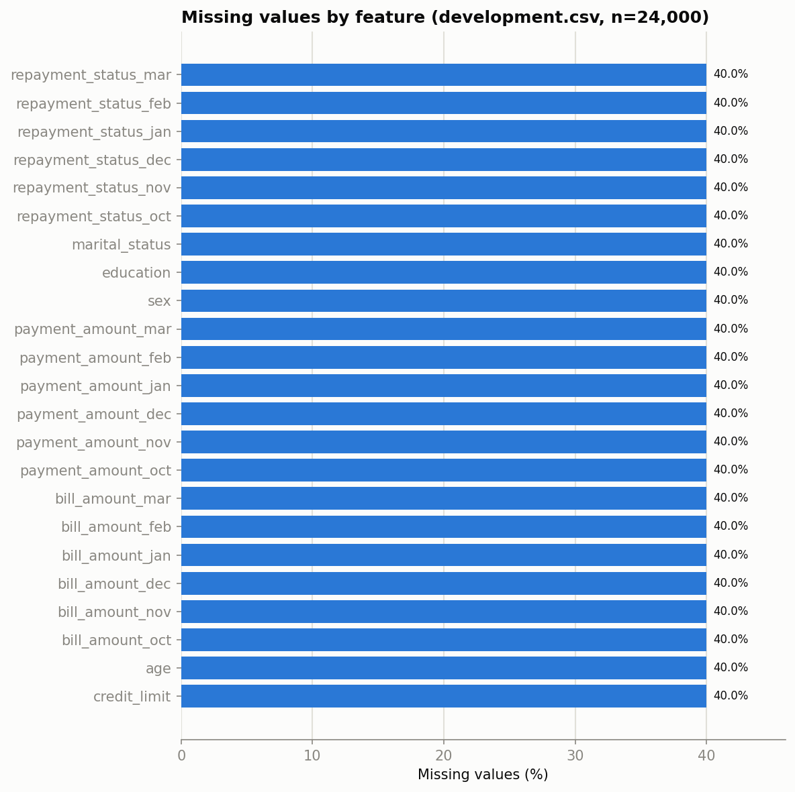
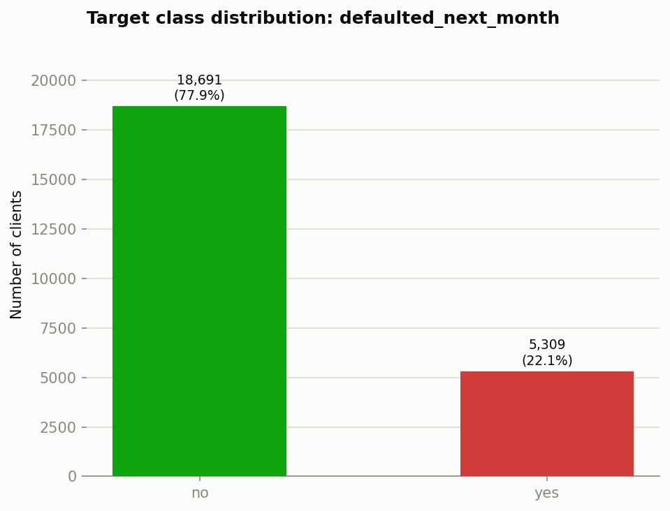
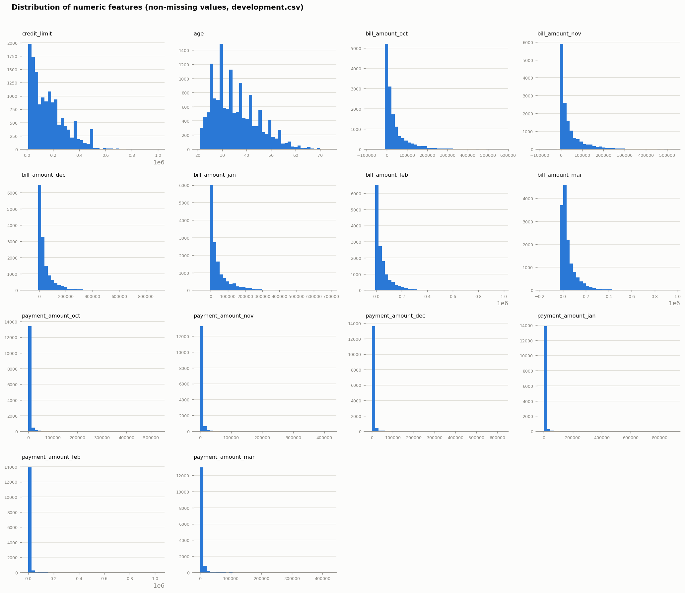
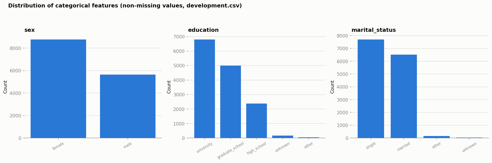
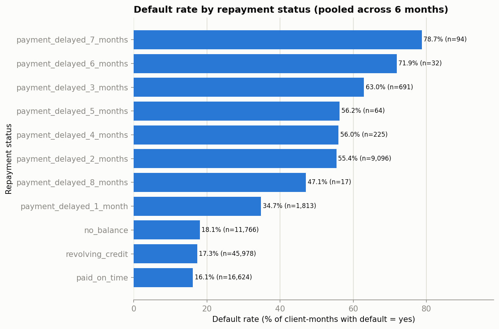
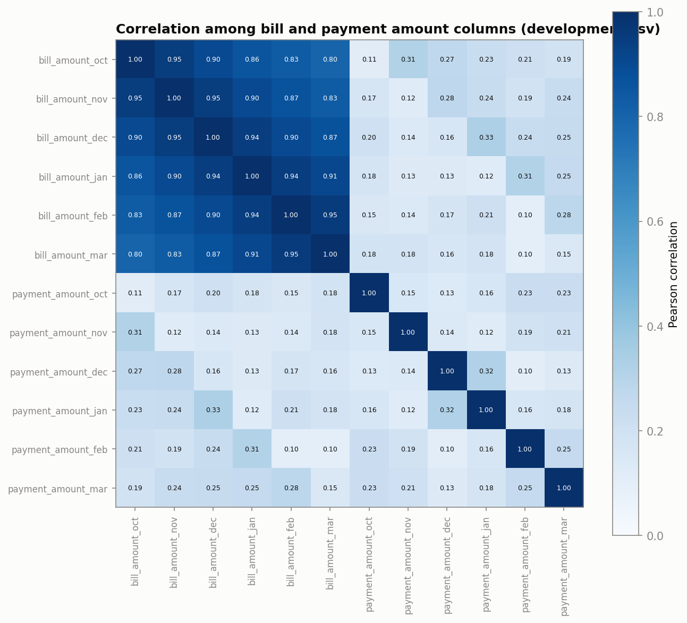
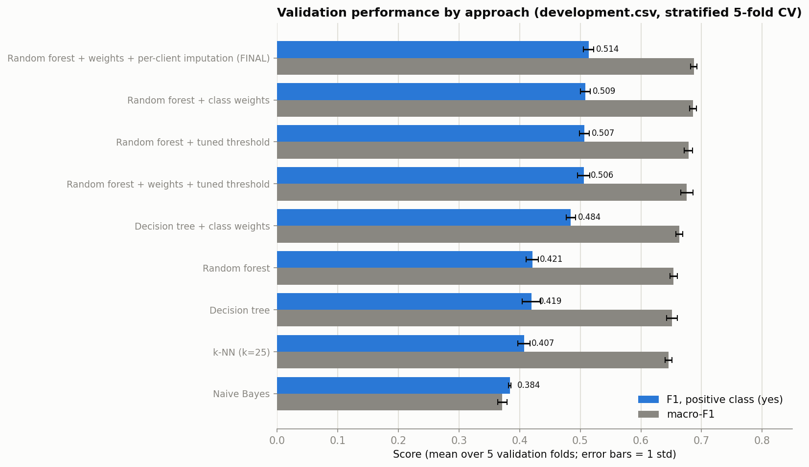

# INFS4203/7203 Project (Track 1): Credit-card default classifier

Student: s4802160 \
Target: `defaulted_next_month` (`yes` = default)

**Final model:** random forest (200 trees, `min_samples_leaf=10`, `class_weight='balanced'`, `random_state=42`) with **per-client imputation** of the bill and
payment columns (a missing month is filled from the same client's other months), mean-imputed ordinal repayment status, and the default 0.5 cut-off.
**Validation (stratified 5-fold CV on `development.csv`, held-out folds only):**

| Metric | Mean | Std |
|---|---|---|
| Accuracy | 0.783 | 0.004 |
| Precision (yes) | 0.510 | 0.010 |
| Recall (yes) | 0.517 | 0.008 |
| **F1 (yes)** | **0.514** | **0.008** |
| Macro-F1 | 0.687 | 0.006 |
| Balanced accuracy (extra diagnostic) | 0.688 | 0.005 |

The last row of `s4802160.infs4203` is `0.783,0.510,0.517,0.514,0.687,`.

## 1. How to run and replicate the notebooks results

```
python main.py
```

Run with `development.csv` and `test.csv` in the same folder. It prints the five CV metrics, refits the final
pipeline on all of `development.csv`, predicts `test.csv` in its original order and writes the `s4802160.infs4203`with all the results and metrics
(6,000 `yes,`/`no,` rows + 1 metrics row). It takes about 30 seconds should produce the same outputs every time.
`development.ipynb` contains all exploration, comparison and tuning (about 15 minutes to run top to bottom; it saves the plots to `figures/`).

**Environment:** Windows 11 Home (10.0.26200), Python 3.12.9, scikit-learn 1.6.1, pandas 2.2.3, numpy 2.1.3, matplotlib 3.10.3, scipy (as installed with scikit-learn).
**Seeds:** 42 everywhere (`StratifiedKFold(shuffle=True, random_state=42)`, every `random_state`). The imputation comparison in notebook Section 6.2 also uses fold-shuffle seeds 1 and 2 as a robustness check, stated where used.

## 2. Initial data audit

- `development.csv`: 24,000 rows x 25 columns; `test.csv`: 6,000 rows x 24 columns (no target). `client_id` is an identifier and was never used as a predictor.
- Feature types: 14 numeric (`credit_limit`, `age`, 6 `bill_amount_*`, 6 `payment_amount_*`), 3 categorical (`sex`, `education`, `marital_status`),
  6 repayment-status labels (`repayment_status_oct..mar`, 9-11 distinct values each), 1 target.
- **Target balance:** 18,691 `no` (77.9%) vs. 5,309 `yes` (22.1%). Predicting "no" for everyone gives 78% accuracy and catches no defaulters, which is why we optimise positive-class F1 and uses stratified folds (every validation fold has a 22.1% default rate).
- **Missing values:** each of the 23 predictors is missing in exactly 9,600 rows (40%), but in *different* rows: only 17 rows miss everything, while 98.3% of
  rows miss at least one value. Deleting incomplete rows would discard almost all the data, so we used imputation.

### Plots and what they show

**Missingness by feature** (`figures/01_missingness.png`)

Every predictor is missing at the same 40% rate, whether numeric, categorical or repayment status. This uniformity could mean missingness was applied independently per column
rather than driven by the values, so we can use imputation for every column, and it is the largest limit on achievable accuracy (see Section 6). Because the gaps fall in different
rows for different columns, a client usually still has *other* months observed, which is a reason to do the per-client imputation in Section 3.

**Target class distribution** (`figures/02_target_distribution.png`)

The 78/22 imbalance motivates F1 on `yes`, stratified CV, and the class-weighting / threshold experiments in Section 4.

**Numeric feature distributions** (`figures/03_numeric_distributions.png`)

`credit_limit`, all bill amounts and especially all payment amounts are heavily right-skewed (skewness 1.0, 2.6-2.9 and 10-21 respectively), `age` is mild (0.75).
This predicts potential issues for Gaussian Naive Bayes, is irrelevant to trees (they use only value ordering), and is the reason numerics are standardised for k-NN.

**Categorical feature distributions** (`figures/04_categorical_distributions.png`)

Each categorical has a couple of dominant values and tiny residual buckets (`unknown`, `other`). They don't have a natural order, so they are one-hot encoded and the small buckets are kept.

**Default rate by repayment status** (`figures/05_repayment_status_default_rate.png`)

Pooling the six months: `paid_on_time` 16%, `revolving_credit` 17%, `no_balance` 18% are pretty much indistinguishable, and risk goes up to to 35% at a 1-month delay, 55% at 2 months and 63-79% at 3-7 months.
Delay length is roughly the same (the few dips are in categories with 17-225 rows), but the three "not delayed" labels carry no order. This justifies the ordinal encoding "not delayed = 0, otherwise number of months late".

**Bill/payment correlation** (`figures/06_bill_payment_correlation.png`)

The six bill columns are near-duplicates (pairwise correlation 0.80-0.95, adjacent months about 0.95), whereas payments are only weakly correlated with each other (0.18) and with bills (0.20).
This goes against Naive Bayes' independence assumption, and it is also what makes a client's other bill months an excellent estimate of a missing one (Section 3, per-client imputation).

## 3. Preprocessing alternatives tested

All preprocessing is inside an sklearn `Pipeline`/`ColumnTransformer`, so it is refit on each training fold only. There isn't anything that is fit on validation rows.

| Choice | Alternatives tested | Outcome |
|---|---|---|
| Imputation | column mean / median / mode via `SimpleImputer`; for trees "leave NaN" using their built-in missing-value support; **per-client** imputation (Section 4, Table B) | **Per-client imputation wins** (F1 +0.007, consistent on every fold shuffle). "Leave NaN" for trees gave no reliable gain. Class-specific imputation (Lecture 2) is excluded because it needs the label, which `test.csv` does not have. |
| Repayment-status encoding | one-hot vs. ordinal (not delayed = 0, otherwise months late) | Ordinal better: k-NN +0.07 F1, trees +0.01. |
| Scaling | `StandardScaler` on numerics vs. none | Essential for k-NN (F1 0.18 → 0.39); irrelevant for trees and Naive Bayes. |
| Imbalance handling | `class_weight='balanced'`; decision-threshold tuning on `predict_proba` (cut-off 0.10-0.70 chosen *inside* each training fold, nested CV); both together | See Section 4. |


**Why have we used Per-client imputation** It's imputation by an aggregate value (replace a missing value by the mean of the available values), but taken
over the *client's own* other months instead of over all clients. A missing `bill_amount_X` should become the mean of that client's observed bills in the other five months (same for payments);
if the client has none observed, the training-fold column mean is used. It (a) uses no label and no other client's row at transform time, so it behaves identically on `test.csv`;
(b) creates no new columns (so it is imputation, not feature engineering); (c) is fitted inside each training fold (the only fitted quantity is the fallback column mean);
and (d) is motivated by the data: bills are correlated at about 0.95 month to month, so the client's own history is far better evidence than the population mean. It does not use
any assumed relationship between repayment status and bills/payments. It is a slightly modified method derived from other techniques.

## 4. Classifiers, hyperparameters and validation procedure

- **Validation:** stratified 5-fold CV, `shuffle=True`, seed 42, identical folds for every model. All numbers below are means (± std) over the 5 held-out folds unless stated.
- **Models:** Gaussian Naive Bayes, k-NN, decision tree, random forest. Tuning with `GridSearchCV(scoring='f1')` on the same folds.
- **Grids:** k-NN `n_neighbors` ∈ {1, 3, …, 41}, `p` ∈ {1, 2}; decision tree `max_depth` ∈ {3, 5, 7, 10, None}, `min_samples_leaf` ∈ {1, 5, 20, 50, 100}, `criterion` ∈ {gini, entropy};
  random forest `n_estimators` = 200, `max_depth` ∈ {5, 8, 12, None}, `min_samples_leaf` ∈ {1, 5, 10, 20}, `criterion` ∈ {gini, entropy}; Naive Bayes has no hyperparameters.
  Each tree grid was run with and without `class_weight='balanced'`.
- **Threshold tuning:** for each outer fold, the cut-off maximising F1 is chosen on out-of-fold predictions inside that fold's training rows (inner 5-fold split) and applied once to the untouched validation fold.

### Baselines (default hyperparameters, best preprocessing per model, see the full table in the notebook, Section 5)

| Model | Preprocessing | F1 (yes) | Std |
|---|---|---|---|
| Naive Bayes | ordinal, impute | 0.384 | 0.002 |
| k-NN (k=5) | ordinal, impute, scale | 0.386 | 0.003 |
| Decision tree | one-hot, keep NaN | 0.373 | 0.012 |
| Random forest | ordinal, impute | 0.412 | 0.013 |

**Trivial reference points (no model; notebook Section 5):** predicting "no default" for everyone gives accuracy 0.779 but F1 = 0; predicting "default" for everyone gives F1 **0.362** (precision 0.221, recall 1.0). 0.362 is therefore the floor a useful model must clearly beat, and Naive Bayes (0.384) is barely above it.

### Table A: tuned models and the final comparison



| Approach | F1 (yes) | Macro-F1 | Balanced acc | Precision | Recall | Accuracy |
|---|---|---|---|---|---|---|
| **Random forest + class weights + per-client imputation (FINAL)** | **0.514 ± 0.008** | 0.687 ± 0.006 | 0.688 ± 0.005 | 0.510 | 0.517 | 0.783 |
| Random forest + class weights (mean imputation; leaf 10, gini) | 0.509 ± 0.008 | 0.686 ± 0.006 | 0.684 ± 0.005 | 0.519 | 0.499 | 0.787 |
| Random forest + tuned threshold (≈0.27) | 0.507 ± 0.008 | 0.678 ± 0.007 | 0.685 ± 0.005 | 0.483 | 0.533 | 0.770 |
| Random forest + weights + tuned threshold (≈0.47) | 0.506 ± 0.010 | 0.676 ± 0.010 | 0.685 ± 0.006 | 0.475 | 0.542 | 0.765 |
| Decision tree + class weights (depth 5, leaf 100) | 0.484 ± 0.008 | 0.663 ± 0.006 | 0.671 ± 0.007 | 0.463 | 0.514 | 0.758 |
| Random forest (leaf 1, no weights) | 0.421 ± 0.010 | 0.654 ± 0.006 | 0.632 ± 0.005 | 0.652 | 0.311 | 0.811 |
| Decision tree (depth 7, no weights) | 0.419 ± 0.015 | 0.651 ± 0.009 | 0.631 ± 0.007 | 0.618 | 0.318 | 0.806 |
| k-NN (k=25, Euclidean, no weights) | 0.407 ± 0.010 | 0.646 ± 0.006 | 0.625 ± 0.005 | 0.627 | 0.302 | 0.806 |
| Gaussian Naive Bayes | 0.384 ± 0.002 | 0.372 ± 0.008 | 0.555 ± 0.004 | 0.245 | 0.884 | 0.372 |

**What Table A shows (also interpreted in the notebook):**
- Unweighted models plateau at F1 ≈ 0.41-0.42 however they are tuned: with 22% defaulters, a 0.5 cut-off finds only ~30% of them. Hyperparameters are not the bottleneck, the decision rule is.
- Class weighting lifts the forest to 0.509 and the tree to 0.484. Tuning the threshold on an unweighted forest reaches the same operating point (0.507); doing both adds nothing (0.506).
  All three are within 0.004, i.e. well inside the fold std (≈ 0.01), so the simplest (weights, 0.5 cut-off) was kept.
- The forest beats the single tree by 0.03 F1 once weighted, so the ensemble helps. k-NN and Naive Bayes are clearly weaker; Naive Bayes calls 88% of clients defaulters because of the correlated bills and skewed amounts.
- Per-client imputation adds the last +0.005 (0.509 → 0.514 on the seed-42 folds, +0.007 averaged over three fold shuffles; Table B).

### Table B: imputation methods (random forest + class weights, mean F1 over 3 fold shuffles, see notebook Section 6.2)

| Imputation | F1 mean | seed 42 | seed 1 | seed 2 |
|---|---|---|---|---|
| **Per-client: bills + payments (chosen)** | **0.5137** | 0.5138 | 0.5143 | 0.5131 |
| Per-client: bills + payments + repayment | 0.5136 | 0.5128 | 0.5151 | 0.5130 |
| Per-client: bills only | 0.5119 | 0.5129 | 0.5117 | 0.5110 |
| Per-client: payments only | 0.5092 | 0.5086 | 0.5089 | 0.5101 |
| Column mean (baseline) | 0.5064 | 0.5076 | 0.5059 | 0.5058 |
| Column median | 0.5063 | 0.5073 | 0.5062 | 0.5054 |

Per-client imputation beats the column mean on every fold shuffle, whereas using the median instead of the mean makes no difference.

## 5. Final pipeline used to produce results

1. Map `repayment_status_*` to numbers: `no_balance`, `paid_on_time`, `revolving_credit` → 0; `payment_delayed_k_month(s)` → k (fixed dictionary, nothing learned from data).
2. `credit_limit`, `age`, bills, payments: `PerClientImputer` (bills filled from the client's other bill months, payments from the other payment months, leftovers with the training-fold column mean). No scaling.
   `sex`, `education`, `marital_status`: `SimpleImputer('most_frequent')` then `OneHotEncoder(handle_unknown='ignore')`. Ordinal repayment columns: `SimpleImputer(strategy='mean')`.
3. `RandomForestClassifier(n_estimators=200, max_depth=None, min_samples_leaf=10, criterion='gini', class_weight='balanced', random_state=42)`, standard 0.5 cut-off.
4. Validation metrics above come from stratified 5-fold CV of exactly this pipeline; the pipeline is then refit on all 24,000 development rows to predict the 6,000 test rows (1,420 predicted `yes`, 23.7%, close to the 22.1% development default rate).

## 6. Limitations, surprises and what did not work

- **40% missing per column is the main ceiling.** Even with the best imputation found (per-client), F1 only moved from 0.506 to 0.514. 
- **Optimism:** many configurations were compared on the same folds, so the best CV score is slightly optimistic; the hidden-test F1 will differ by sampling noise too (fold std ≈ 0.008, larger for one 6,000-row sample). Expect roughly 0.50-0.51, not the CV number exactly.
- **Naive Bayes** fails for the two reasons identified in the EDA (near-duplicate bill columns, heavily skewed amounts). No log-transform or feature engineering was tried.
- **Threshold tuning and class weighting gave the same result**, so neither is strictly needed or better than the other, the class weights were chosen for simplicity and zero tuning optimism.
- **Techniques beyond the weekly guides, suggested by Ed Discussion/Claude:** `Pipeline`, `ColumnTransformer`, `StratifiedKFold`, `cross_validate`, `class_weight` and threshold tuning, `SimpleImputer`,
  one small custom imputer class (`PerClientImputer`, built from aggregate-value imputation);
  and standard tree hyperparameters (`max_depth`, `min_samples_leaf`, `n_estimators`).

## 7. Files

- `main.py`: final pipeline only. `development.ipynb`: full EDA, preprocessing trials, model comparison, tuning, final selection.
- `s4802160.infs4203`: predictions + metrics row. `figures/`: plots embedded above. `ai-usage.md`: disclosure of AI assistance.
